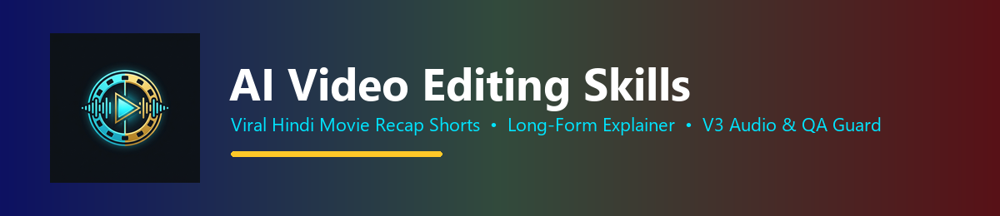

<div align="center">

<!-- Local Studio Banner (Zero External Dependency) -->


<br/><br/>

<!-- Animated Typing Tagline -->
<a href="https://github.com/gmakercodeby-arch/ai-video-editing-skills">
  
</a>

<br/>

<!-- Tech Stack & Repo Badges -->
<p>
  
  
  
  
  
  
</p>

<p>
  <a href="https://github.com/gmakercodeby-arch/ai-video-editing-skills/stargazers">
    
  </a>
  <a href="https://github.com/gmakercodeby-arch/ai-video-editing-skills/network/members">
    
  </a>
  <a href="https://github.com/gmakercodeby-arch/ai-video-editing-skills/issues">
    
  </a>
  
</p>

<!-- Quick Jump Navigation -->
<p>
  <a href="#-4-production-ready-modes"><b>Modes</b></a> •
  <a href="#%EF%B8%8F-v3-locked-pipeline-architecture"><b>Architecture</b></a> •
  <a href="#-key-features-v3-locked-pipeline"><b>Features</b></a> •
  <a href="#-quick-install-smart-pc-scanner"><b>Quick Install</b></a> •
  <a href="#-system-requirements"><b>System Specs</b></a> •
  <a href="#-repository-structure"><b>Structure</b></a>
</p>

</div>

---

## 🎯 4 Production-Ready Modes

<table>
  <tr>
    <td width="50%" valign="top">
      <h3>📱 1. Viral Hindi Movie Recap Shorts</h3>
      <code>1080×1920 @ 30fps</code> • Vertical Retention Engine<br/><br/>
      Built for high-retention recap channels in <b>@CineKahaniHindi75</b> / <b>@MUNDAEXPLAIN</b> style with snappy word-synced cuts and Devanagari hook banners.
    </td>
    <td width="50%" valign="top">
      <h3>🎬 2. Long-Form Movie Explained</h3>
      <code>1920×1080 Full HD</code> • 12–22 Mins<br/><br/>
      Structured storytelling pipeline inspired by <b>Filmy Nest</b> / <b>ZN Explain</b> style with consistent pacing, copyright protection, and clean audio mastering.
    </td>
  </tr>
  <tr>
    <td width="50%" valign="top">
      <h3>🗣️ 3. Conversational Video Editing</h3>
      <code>video-use</code> • General Purpose Skill<br/><br/>
      Flexible AI-assisted video editing workflow for trimming, assembling, styling, and automating everyday video tasks via natural instructions.
    </td>
    <td width="50%" valign="top">
      <h3>🔍 4. Mandatory Post-Render QA Engine</h3>
      <code>ffmpeg-video-qa-engine</code> • Automated Verification<br/><br/>
      Every export is audited with banner zoom crops, 3×3 visual storyboards, <code>-14 LUFS</code> EBUR128 loudness checks, and Whisper transcript similarity.
    </td>
  </tr>
</table>

---

## ⚙️ V3 Locked Pipeline Architecture


---

## ✨ Key Features (V3 Locked Pipeline)

| Module | File Path | Core Capability |
| :--- | :--- | :--- |
| 🔤 **Pre-TTS Hindi Normalizer** | `pipeline/hindi_normalizer.py` | Converts English digits, years (`1947` → `उन्नीस सौ सैंतालीस`), decimals, and acronyms (`LAPD` → `एल ए पी डी`) into pure spoken Hindi before TTS. |
| 🛡️ **Zero-Bypass Audio Guard** | `pipeline/audio_guard.py` | Audits every beat with `faster-whisper (small, int8, CPU)` — enforces `sim >= 0.72`, `max_gap <= 8`, last-word intact check, `-52dB` trim + `65ms` safety padding, max 3 retries + clean `edge-tts` fallback. |
| ✂️ **Zero Blind Timestamps** | `pipeline/shot_guard.py` | Combines `PySceneDetect` shot boundaries + 3-frame probe (`0s, +1.5s, +3.0s`) + Whisper `word_timestamps` so cuts land exactly `0.06s` before the spoken cue word. |
| ✍️ **HarfBuzz Devanagari Overlays** | `pipeline/overlay_kit.py` | Renders all Hindi banner hooks & pop captions via `libass` (`Spacing=0`) — **zero broken matras!** |
| 🔒 **Copyright Shield** | Integrated in Render Pipeline | Mutes original audio, smart `hflip` (skips readable clocks/signs), `<= 4.45s` max cut length, `1.03x` speed shift, Cold Teal LUT, micro-sharpening, and subtle film grain. |
| 📊 **Post-Render Video QA** | `skills/ffmpeg-video-qa-engine/scripts/qa_inspect_video.py` | Auto-generates `qa_banner_zoom.png`, 3×3 storyboard grid, EBUR128 loudness (`-14 LUFS`), and Whisper similarity report. |
| 🚦 **Pre-Render Contract Linter** | `pipeline/project_linter.py` | Audits manifests, frame-exact timestamps (`floor(frame/fps)`), ASS Devanagari `Spacing=0`, 80% title-safe margins, A/V drift, and HTML motion contracts BEFORE rendering (with exact `Fix:` lines). |
| 🧬 **100% Free Style Cloner** | `pipeline/style_cloner.py` | Analyzes any reference video's frame-exact cuts, pacing cadence, color mood (auto-builds FFmpeg grade), EBUR128 loudness, and 3×3 storyboard locally — zero \$25/mo paywall. |
| 🎞️ **HTML/GSAP Motion Bridge** | `pipeline/html_motion.py` | Generates editable After Effects-style motion cards (`glass_hook`, `vox_newspaper`, `stat_counter`, `kinetic_title`) using the open-source HyperFrames HTML contract with dual HyperFrames CLI / FFmpeg rendering. |

---

## 🚀 Quick Install (Smart PC Scanner)

> Skips tools that are already installed on your machine — zero bloat, clean isolated setup.

```powershell
git clone https://github.com/gmakercodeby-arch/ai-video-editing-skills.git
cd ai-video-editing-skills
powershell -ExecutionPolicy Bypass -File .\install.ps1
```

### What `install.ps1` Does Automatically
- 🔎 **Scans your PC** for `python`, `ffmpeg`, `git`, and NVIDIA GPU hardware.
- ⏭️ **Skips existing tools** already present in PATH.
- 📦 **Builds an isolated `.venv`** with all required Python dependencies.
- 🧩 **Installs all 9 skills** directly into `~/.gemini/config/skills/`.
- 🎙️ **Voice engine choice:** Optionally sets up local zero-shot **OmniVoice** cloning, or defaults to fast cloud **`edge-tts`**.

---

## 💻 System Requirements

This pipeline adapts automatically to your hardware. Even a standard laptop runs the complete editing + `edge-tts` pipeline smoothly, while a **6 GB+ CUDA GPU** unlocks **15×–30× faster** local **OmniVoice** voice cloning.

| Component | ☁️ Minimum (`edge-tts` Cloud Voice Mode) | ⚡ Recommended (Fast Local `OmniVoice` Cloning) |
| :--- | :--- | :--- |
| **OS** | Windows 10 / 11 (64-bit) | Windows 11 (64-bit) |
| **CPU** | 4-Core Intel i5 / Ryzen 5 | 6-Core+ Intel i5 (11th Gen+) / Ryzen 5 5600+ |
| **RAM** | **8 GB** | **16 GB+** |
| **GPU** | Integrated / Any CPU (no GPU needed) | **NVIDIA GTX 1660 SUPER (6 GB) / RTX 3060 (12 GB)** (`CUDA sm_70+`, **6 GB+ VRAM**) |
| **Disk Space** | **~2 GB free** (+ space for movies) | **~8–10 GB free** (OmniVoice + Whisper models + cache) |
| **Internet** | Required for `yt-dlp` & `edge-tts` | Optional once models are cached |

> [!NOTE]
> **Older GPUs (e.g., GTX 960M / `sm_50`):** Modern PyTorch (`cu128`) requires CUDA Compute Capability **`7.0+`** (GTX 16-series / RTX 20/30/40-series). On older GPUs, OmniVoice automatically falls back to CPU (slower) — switch to **`edge-tts` mode** for fast 1–2 min renders!

---

## 🤖 Recommended AI Models (Free / Budget / Pro)

| Task | 💸 Free / Low-End PC (CPU) | ⚡ Budget GPU (`GTX 1660 SUPER 6GB` / `RTX 3060`) | 🏆 Pro Studio (`RTX 4070+` / Cloud) |
| :--- | :--- | :--- | :--- |
| **Hindi Voice / Cloning** | **`edge-tts`** (`hi-IN-MadhurNeural`, zero-glitch, free) | **`OmniVoice`** (`k2-fsa/OmniVoice` FP16 local cloning) | **`OmniVoice` + ElevenLabs** (ultra-expressive dubs) |
| **Audio QA & Word-Sync** | **`faster-whisper small`** (`int8`, CPU-safe) | **`faster-whisper medium`** (`float16`, CUDA) | **`faster-whisper large-v3`** (GPU) |
| **Script & Scene Reasoning** | **Gemini 2.5 Flash / 3.8 Flash** | **Gemini 4 Medium / Claude Sonnet** | **Gemini 4 Pro / Claude Opus** |
| **Thumbnails & Logos** | **Built-in Image Generator / Flux Schnell** | **SDXL / Flux.1 Dev (8–12GB VRAM)** | **Flux.1 Pro / Imagen 3** |

---

## 📺 5th Skill: YouTube Auto-Uploader (`youtube-auto-uploader`)
- Uses the official **YouTube Data API v3** (`pipeline/youtube_upload.py`) with OAuth2 token caching.
- Auto-sets **Hinglish CTR Title**, SEO tags (`#Shorts` / `#MovieExplained`), CC-BY attribution, and **1280×720 custom thumbnails**.
- Defaults to `privacy="private"` so you can review before publishing!

---

## 🎨 Ready-Made Pro Templates & 🎵 Copyright-Free Audio Library (`pro-recap-templates-audio`)
- **4 Pre-Made Transparent Cinema Templates (`templates/` + `pipeline/template_kit.py`):** Just overlay & drop your Hindi title/hook via `libass`!
  - `template_dark_gold.png` (9:16 Mystery / Thriller)
  - `template_crimson_horror.png` (9:16 Horror / Zombie / Monster)
  - `template_cyan_scifi.png` (9:16 Sci-Fi / Cyberpunk HUD)
  - `template_cinema_16x9.png` (16:9 Long-Form Filmy Nest matte-black bar)
- **120+ 100% Copyright-Free Procedural 48kHz Audio Lab (`pipeline/audio_lab.py` + `pipeline/music_kit.py`):**
  - **60 BGM Presets** across 12 genres (`thriller`, `horror`, `scifi`, `crime_noir`, `emotional`, `action`, `mystery`, `survival`, `documentary`, `anime_epic`, `suspense`, `space_void` × 5 variations each!)
  - **60 Designed SFX Presets** across 6 categories (`boom_impact`, `whoosh_cut`, `riser_tension`, `heartbeat`, `glitch_hit`, `bell_reveal` × 10 variations each!)
  - Generate the entire **120-track local audio pack** in 1 command: `python pipeline/audio_lab.py --build-pack assets/audio_lab` (zero GitHub repo bloat, 0% copyright claim risk!)
- **Curated Stock Audio & Open-Source Best Practices:** Includes verified free audio sources (YouTube Audio Library, Pixabay, Mixkit, Freesound CC0, Incompetech) + distilled patterns from `NarratoAI`, `ClipsAI`, `Remotion Shorts`, and `MoneyPrinterTurbo`.

---

## 📁 Repository Structure

```text
ai-video-editing-skills/
├── 📜 install.ps1                        # Smart PC-scanning installer
├── 📦 requirements.txt                   # Python dependencies
├── 🔐 .env.example                       # Optional Telegram delivery config
│
├── 🐍 pipeline/                          # Reusable Python modules (V3 Locked)
│   ├── hindi_normalizer.py               # Pre-TTS Devanagari number/acronym normalizer
│   ├── audio_guard.py                    # Whisper verification + retry + edge-tts fallback
│   ├── whisper_worker.py                 # faster-whisper int8 transcription worker
│   ├── shot_guard.py                     # PySceneDetect + 3-frame probe + word cue cuts
│   ├── overlay_kit.py                    # libass / HarfBuzz Devanagari banners & captions
│   ├── music_kit.py                      # Background music mixing & ducking
│   ├── audio_lab.py                      # 120+ copyright-free BGM (60) & SFX (60) generator
│   ├── motion_gfx.py                     # Animated lower-thirds & stat counters (cubic easing)
│   ├── html_motion.py                    # Free HTML/CSS/GSAP motion cards + HyperFrames CLI bridge
│   ├── style_cloner.py                   # 100% Free reference video pacing, color & LUFS analyzer
│   ├── project_linter.py                 # Pre-render contract linter (safe zones, frame math, ASS)
│   ├── smart_editor.py                   # 1-command auto-editor for ANY user video (vlogs/tutorials)
│   ├── send_telegram.py                  # Automated Telegram delivery
│   ├── youtube_upload.py                 # Official YouTube Data API v3 uploader
│   ├── instagram_upload.py               # Official Meta Instagram Graph API Reels uploader
│   ├── template_kit.py                   # 4 ready-made 9:16 & 16:9 cinema templates
│   └── example_build_short.py            # End-to-end sample short builder
│
├── 🎨 templates/                         # Pre-made 9:16 & 16:9 transparent PNG templates
└── 🧠 skills/                            # 9 Antigravity Global Skills
    ├── viral-shorts-mastery/             # 1080×1920 Viral Hindi Recap Shorts
    ├── long-form-movie-recap/            # 1920×1080 Long-Form Movie Explained
    ├── ffmpeg-video-qa-engine/           # Post-Render QA & EBUR128 Inspector
    ├── video-use/                        # General Conversational Video Editing
    ├── youtube-auto-uploader/            # YouTube Data API v3 Upload & SEO Skill
    ├── pro-recap-templates-audio/        # Templates, 120+ Audio Lab & Open-Source Recipes
    ├── hyperframes-motion-bridge/        # HTML/CSS/GSAP Motion Graphics + HyperFrames Contract
    ├── free-style-cloner/                # Zero-Paywall Reference Style Cloner & Pre-Render Linter
    └── ai-story-reel-generator/          # 3D AI Character Stories (Sheru & Aloo Style) + Auto Instagram
```

---

<div align="center">

---

## 🔍 Search Keywords & Use Cases (Google / GitHub / AI Agents)
- **AI Video Editing Skills** for **Antigravity IDE**, **Claude Code**, and automated **FFmpeg** pipelines
- **Hindi Movie Recap Shorts Generator** (`1080x1920`, **YouTube Shorts** & **Instagram Reels** automation)
- **Long-Form Movie Explained Automation** (`1920x1080`, Filmy Nest / ZN Explain style 4-Act structure)
- **Zero-Shot Hindi Voice Cloning** with **OmniVoice** + **`edge-tts`** + **`faster-whisper`** similarity QA guard
- **Devanagari / Hindi ASS Subtitles** with **libass / HarfBuzz** (`Spacing=0`) & **PySceneDetect** word-synced cuts
- **YouTube Auto-Uploader** using official **YouTube Data API v3** with Hinglish CTR titles & custom thumbnails
- **Free HyperFrames HTML/CSS/GSAP Motion Bridge** (`html_motion.py`) for After Effects-grade intros, Vox newspaper highlights, animated stat counters & kinetic titles
- **Zero-Paywall Reference Style Cloner** (`style_cloner.py`) + **Pre-Render Video Contract Linter** (`project_linter.py`) for frame-exact cut rhythm, color grading, and 80% safe-zone checks

---

<div align="center">

### ⭐ If this pipeline saves you editing hours, drop a star on the repo!

<a href="https://github.com/gmakercodeby-arch/ai-video-editing-skills/stargazers">
  
</a>


</div>
