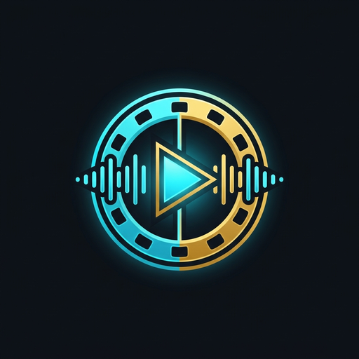

<div align="center">

<!-- Animated Wave Header Banner -->


<!-- Repo Logo -->


<!-- Animated Typing Tagline -->
<a href="https://github.com/gmakercodeby-arch/ai-video-editing-skills">
  
</a>

<br/>

<!-- Tech Stack & Repo Badges -->
<p>
  
  
  
  
  
  
</p>

<p>
  <a href="https://github.com/gmakercodeby-arch/ai-video-editing-skills/stargazers">
    
  </a>
  <a href="https://github.com/gmakercodeby-arch/ai-video-editing-skills/network/members">
    
  </a>
  <a href="https://github.com/gmakercodeby-arch/ai-video-editing-skills/issues">
    
  </a>
  
</p>

<!-- Quick Jump Navigation -->
<p>
  <a href="#-4-production-ready-modes"><b>Modes</b></a> •
  <a href="#%EF%B8%8F-v3-locked-pipeline-architecture"><b>Architecture</b></a> •
  <a href="#-key-features-v3-locked-pipeline"><b>Features</b></a> •
  <a href="#-quick-install-smart-pc-scanner"><b>Quick Install</b></a> •
  <a href="#-system-requirements"><b>System Specs</b></a> •
  <a href="#-repository-structure"><b>Structure</b></a>
</p>

</div>

---

## 🎯 4 Production-Ready Modes

<table>
  <tr>
    <td width="50%" valign="top">
      <h3>📱 1. Viral Hindi Movie Recap Shorts</h3>
      <code>1080×1920 @ 30fps</code> • Vertical Retention Engine<br/><br/>
      Built for high-retention recap channels in <b>@CineKahaniHindi75</b> / <b>@MUNDAEXPLAIN</b> style with snappy word-synced cuts and Devanagari hook banners.
    </td>
    <td width="50%" valign="top">
      <h3>🎬 2. Long-Form Movie Explained</h3>
      <code>1920×1080 Full HD</code> • 12–22 Mins<br/><br/>
      Structured storytelling pipeline inspired by <b>Filmy Nest</b> / <b>ZN Explain</b> style with consistent pacing, copyright protection, and clean audio mastering.
    </td>
  </tr>
  <tr>
    <td width="50%" valign="top">
      <h3>🗣️ 3. Conversational Video Editing</h3>
      <code>video-use</code> • General Purpose Skill<br/><br/>
      Flexible AI-assisted video editing workflow for trimming, assembling, styling, and automating everyday video tasks via natural instructions.
    </td>
    <td width="50%" valign="top">
      <h3>🔍 4. Mandatory Post-Render QA Engine</h3>
      <code>ffmpeg-video-qa-engine</code> • Automated Verification<br/><br/>
      Every export is audited with banner zoom crops, 3×3 visual storyboards, <code>-14 LUFS</code> EBUR128 loudness checks, and Whisper transcript similarity.
    </td>
  </tr>
</table>

---

## ⚙️ V3 Locked Pipeline Architecture

```mermaid
flowchart LR
    A["📝 Raw Hindi Script"] --> B["🔤 Hindi Normalizer<br/>hindi_normalizer.py"]
    B --> C["🎙️ TTS / OmniVoice<br/>+ edge-tts fallback"]
    C --> D["🛡️ Audio Guard<br/>faster-whisper int8<br/>sim ≥ 0.72"]
    D --> E["✂️ Shot Guard<br/>PySceneDetect + 3-Frame Probe<br/>0.06s cue lead"]
    E --> F["🎨 Overlay Kit & Shield<br/>libass HarfBuzz + Cold Teal LUT<br/>≤ 4.45s cuts | 1.03x"]
    F --> G["✅ Post-Render QA<br/>-14 LUFS + 3×3 Storyboard<br/>qa_banner_zoom.png"]

    style A fill:#1e293b,stroke:#38bdf8,color:#fff
    style B fill:#0f4c5c,stroke:#22d3ee,color:#fff
    style C fill:#1d3557,stroke:#60a5fa,color:#fff
    style D fill:#3b0764,stroke:#c084fc,color:#fff
    style E fill:#7c2d12,stroke:#fb923c,color:#fff
    style F fill:#064e3b,stroke:#34d399,color:#fff
    style G fill:#14532d,stroke:#4ade80,color:#fff
```



---

## ✨ Key Features (V3 Locked Pipeline)

| Module | File Path | Core Capability |
| :--- | :--- | :--- |
| 🔤 **Pre-TTS Hindi Normalizer** | `pipeline/hindi_normalizer.py` | Converts English digits, years (`1947` → `उन्नीस सौ सैंतालीस`), decimals, and acronyms (`LAPD` → `एल ए पी डी`) into pure spoken Hindi before TTS. |
| 🛡️ **Zero-Bypass Audio Guard** | `pipeline/audio_guard.py` | Audits every beat with `faster-whisper (small, int8, CPU)` — enforces `sim >= 0.72`, `max_gap <= 8`, last-word intact check, `-52dB` trim + `65ms` safety padding, max 3 retries + clean `edge-tts` fallback. |
| ✂️ **Zero Blind Timestamps** | `pipeline/shot_guard.py` | Combines `PySceneDetect` shot boundaries + 3-frame probe (`0s, +1.5s, +3.0s`) + Whisper `word_timestamps` so cuts land exactly `0.06s` before the spoken cue word. |
| ✍️ **HarfBuzz Devanagari Overlays** | `pipeline/overlay_kit.py` | Renders all Hindi banner hooks & pop captions via `libass` (`Spacing=0`) — **zero broken matras!** |
| 🔒 **Copyright Shield** | Integrated in Render Pipeline | Mutes original audio, smart `hflip` (skips readable clocks/signs), `<= 4.45s` max cut length, `1.03x` speed shift, Cold Teal LUT, micro-sharpening, and subtle film grain. |
| 📊 **Post-Render Video QA** | `skills/ffmpeg-video-qa-engine/scripts/qa_inspect_video.py` | Auto-generates `qa_banner_zoom.png`, 3×3 storyboard grid, EBUR128 loudness (`-14 LUFS`), and Whisper similarity report. |

---

## 🚀 Quick Install (Smart PC Scanner)

> Skips tools that are already installed on your machine — zero bloat, clean isolated setup.

```powershell
git clone https://github.com/gmakercodeby-arch/ai-video-editing-skills.git
cd ai-video-editing-skills
powershell -ExecutionPolicy Bypass -File .\install.ps1
```

### What `install.ps1` Does Automatically
- 🔎 **Scans your PC** for `python`, `ffmpeg`, `git`, and NVIDIA GPU hardware.
- ⏭️ **Skips existing tools** already present in PATH.
- 📦 **Builds an isolated `.venv`** with all required Python dependencies.
- 🧩 **Installs all 4 skills** directly into `~/.gemini/config/skills/`.
- 🎙️ **Voice engine choice:** Optionally sets up local zero-shot **OmniVoice** cloning, or defaults to fast cloud **`edge-tts`**.

---

## 💻 System Requirements

This pipeline adapts automatically to your hardware. Even a standard laptop runs the complete editing + `edge-tts` pipeline smoothly, while a **6 GB+ CUDA GPU** unlocks **15×–30× faster** local **OmniVoice** voice cloning.

| Component | ☁️ Minimum (`edge-tts` Cloud Voice Mode) | ⚡ Recommended (Fast Local `OmniVoice` Cloning) |
| :--- | :--- | :--- |
| **OS** | Windows 10 / 11 (64-bit) | Windows 11 (64-bit) |
| **CPU** | 4-Core Intel i5 / Ryzen 5 | 6-Core+ Intel i5 (11th Gen+) / Ryzen 5 5600+ |
| **RAM** | **8 GB** | **16 GB+** |
| **GPU** | Integrated / Any CPU (no GPU needed) | **NVIDIA GTX 1660 SUPER (6 GB) / RTX 3060 (12 GB)** (`CUDA sm_70+`, **6 GB+ VRAM**) |
| **Disk Space** | **~2 GB free** (+ space for movies) | **~8–10 GB free** (OmniVoice + Whisper models + cache) |
| **Internet** | Required for `yt-dlp` & `edge-tts` | Optional once models are cached |

> [!NOTE]
> **Older GPUs (e.g., GTX 960M / `sm_50`):** Modern PyTorch (`cu128`) requires CUDA Compute Capability **`7.0+`** (GTX 16-series / RTX 20/30/40-series). On older GPUs, OmniVoice automatically falls back to CPU (slower) — switch to **`edge-tts` mode** for fast 1–2 min renders!

---

## 📁 Repository Structure

```text
ai-video-editing-skills/
├── 📜 install.ps1                        # Smart PC-scanning installer
├── 📦 requirements.txt                   # Python dependencies
├── 🔐 .env.example                       # Optional Telegram delivery config
│
├── 🐍 pipeline/                          # Reusable Python modules (V3 Locked)
│   ├── hindi_normalizer.py               # Pre-TTS Devanagari number/acronym normalizer
│   ├── audio_guard.py                    # Whisper verification + retry + edge-tts fallback
│   ├── whisper_worker.py                 # faster-whisper int8 transcription worker
│   ├── shot_guard.py                     # PySceneDetect + 3-frame probe + word cue cuts
│   ├── overlay_kit.py                    # libass / HarfBuzz Devanagari banners & captions
│   ├── music_kit.py                      # Background music mixing & ducking
│   ├── send_telegram.py                  # Automated Telegram delivery
│   └── example_build_short.py            # End-to-end sample short builder
│
└── 🧠 skills/                            # 4 Antigravity Global Skills
    ├── viral-shorts-mastery/             # 1080×1920 Viral Hindi Recap Shorts
    ├── long-form-movie-recap/            # 1920×1080 Long-Form Movie Explained
    ├── ffmpeg-video-qa-engine/           # Post-Render QA & EBUR128 Inspector
    └── video-use/                        # General Conversational Video Editing
```

---

<div align="center">

### ⭐ If this pipeline saves you editing hours, drop a star on the repo!

<a href="https://github.com/gmakercodeby-arch/ai-video-editing-skills/stargazers">
  
</a>


</div>
